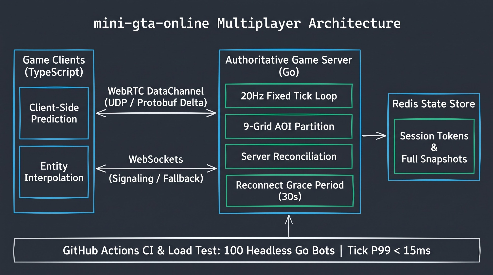

# mini-gta-online

[](https://github.com/BretDeng/mini-gta-online/actions/workflows/ci.yml)

A web-based open-world multiplayer sandbox core built with a **Go 20Hz authoritative game server**, **Pion WebRTC DataChannel + WebSocket hybrid transport**, **Protobuf** wire serialization, **9-Grid AOI** spatial partitioning, **Redis** session/snapshot recovery, and a **TypeScript** debug client — engineered sequentially through **GitHub Issues + Draft PRs + Automated CI Gates**.

## System Architecture



| Layer | Technology & Responsibilities |
| :--- | :--- |
| **Game Clients (`/client`)** | TypeScript + Vite HTML5 Canvas debug client featuring **Client-Side Prediction** and **Entity Interpolation**. |
| **Hybrid Transport** | **WebRTC DataChannel** (Pion `v4`, unordered/unreliable UDP-like channel for high-frequency `ClientInput` & `DeltaSnapshot` Protobuf frames) paired with **WebSockets (`/ws`)** for SDP/ICE signaling, session auth, and automatic fallback. |
| **Authoritative Game Server (`/server`)** | Go 1.23+ **20Hz Fixed Tick Loop** (50ms), **9-Grid AOI Partition** (broadcasting deltas only to the 9-cell neighborhood), **Server Reconciliation**, and **30s Reconnect Grace Period** (after >5s heartbeat timeout). |
| **Redis State Store** | Persists `(session_token, entity_state, last_ack_tick)` and **Full Snapshots** to restore disconnected players seamlessly within the 30s grace window. |
| **CI & Load Verification (`/loadtest`)** | Headless Go simulator spawning **100 concurrent bots** with random movement and 15% abrupt disconnect/reconnect cycles enforced in GitHub Actions. |

## Target Monorepo Structure

```text
mini-gta-online/
├── proto/                  # Protobuf schemas (game.proto)
├── server/                 # Go 1.23+ authoritative game server
├── client/                 # Vite + TypeScript HTML5 Canvas debug client
├── loadtest/               # 100-bot headless Go load & chaos test suite
├── docs/                   # Architecture diagram & Devin kickoff prompt
├── .github/workflows/
│   └── ci.yml              # Automated verification & load-test gate
├── docker-compose.yml      # One-command Game Server + Redis stack
└── Makefile                # Protobuf compilation, build, test, & loadtest targets
```

## Milestone 1: Authoritative Multiplayer Core

Milestone 1 is tracked as four sequential issues ([Milestone 1](https://github.com/BretDeng/mini-gta-online/milestone/1)) executed one PR at a time:

| Task | Issue | Scope | Verification Gate |
| :--- | :--- | :--- | :--- |
| **Task 1** | [#1](https://github.com/BretDeng/mini-gta-online/issues/1) | Monorepo scaffolding (`server/`, `client/`, `proto/`), `game.proto`, `Makefile` (`make proto`), `docker-compose.yml` (Server + Redis) | `make proto`, `docker compose config`, Go & TS skeleton builds green |
| **Task 2** | [#2](https://github.com/BretDeng/mini-gta-online/issues/2) | 20Hz authoritative tick loop, `/ws` signaling/fallback + Pion WebRTC DataChannel, 9-Grid AOI spatial grid | `go test -race ./...` including cross-cell AOI enter/leave unit tests |
| **Task 3** | [#3](https://github.com/BretDeng/mini-gta-online/issues/3) | Session Token auth, >5s heartbeat timeout -> 30s grace period, Redis persistence & `FullSnapshot` reconnect recovery | E2E integration test: drop client -> wait 10s -> reconnect with old token -> recover state |
| **Task 4** | [#4](https://github.com/BretDeng/mini-gta-online/issues/4) | 100-bot headless Go load simulator (movement + 15% random disconnect/reconnect) & strict GitHub Actions CI gates | Tick P99 `< 15ms`, reconnect recovery `100%`, zero goroutine leaks |

## CI Acceptance Redlines

PRs in Milestone 1 must pass all automated checks before merge:
- **Race-clean tests:** `go test -race ./...` passes across all unit and Redis reconnect integration tests.
- **100-Bot Chaos Load Test:** 100 concurrent headless Go bots performing continuous movement with 15% abrupt disconnects and token-based reconnects.
- **Latency SLO:** Server Tick duration **P99 < 15ms** (within the 50ms / 20Hz tick budget).
- **Reliability & Hygiene:** **100%** reconnect state recovery rate and **zero goroutine leaks**.

## Devin Kickoff & Workflow

See [docs/DEVIN_KICKOFF.md](./docs/DEVIN_KICKOFF.md) for the exact Milestone 1 kickoff specification.

Workflow rules:
1. Work strictly in sequence from **Issue #1 -> #2 -> #3 -> #4**.
2. Open a focused PR per issue referencing `Closes #<issue_number>`.
3. Ensure GitHub Actions `CI` is completely green before merging and moving to the next issue.

## Phase 2 Roadmap

Once the minimal TypeScript debug client demo and 100-bot load-test report are green in Milestone 1, Phase 2 will introduce:
- Authoritative vehicle physics and driving state sync
- Chunked open-world map streaming and collision meshes
